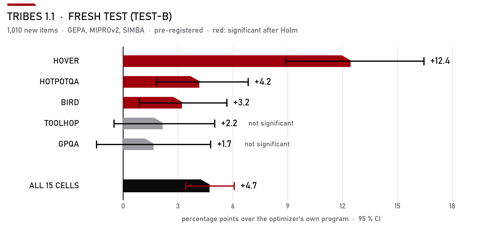

<p align="center">
  <picture>
    <source media="(prefers-color-scheme: dark)" srcset="https://raw.githubusercontent.com/daglar-dragomirov/tribes/main/assets/lockup-dark.png">
    
  </picture>
</p>

<p align="center">
Inference-time answer selection for optimized DSPy programs
</p>

<p align="center">
  <a href="https://daglar-dragomirov.github.io/tribes/"><b>Website</b></a> &nbsp;|&nbsp;
  <a href="https://daglar-dragomirov.github.io/tribes/guides/quickstart/"><b>Quick Start</b></a> &nbsp;|&nbsp;
  <a href="https://daglar-dragomirov.github.io/tribes/results/"><b>Results</b></a> &nbsp;|&nbsp;
  <a href="research/"><b>Research</b></a> &nbsp;|&nbsp;
  <a href="https://pypi.org/project/tribes/"><b>PyPI</b></a>
</p>

<p align="center">
  <a href="https://pypi.org/project/tribes/"></a>
  <a href="https://pypi.org/project/tribes/"></a>
  <a href="https://github.com/daglar-dragomirov/tribes/stargazers"></a>
  <a href="LICENSE"></a>
</p>

---

## What is TRIBES?

A prompt optimizer such as GEPA, MIPROv2 or SIMBA turns your data into one fixed [DSPy](https://github.com/stanfordnlp/dspy)
program. That program is good, but it is also brittle: it cannot look anything up, cannot run code to check itself, and
every answer is a single sample. TRIBES does not touch the optimization. It wraps the finished program with a
reviewer of its draft and an independent agent, picks one answer per input with a label-free rule, and switches itself
off on any task where it is not at least as good as the program.

## Install

```bash
pip install tribes
```

## Quickstart

```python
import dspy
import tribes
from tribes import Tribes

dspy.configure(lm=dspy.LM("openrouter/z-ai/glm-5.3-flash"))

program = dspy.GEPA(metric=metric, ...).compile(student, trainset=train, valset=val)   # or MIPROv2, SIMBA, ...

pt = Tribes(program, mode="full", examples=train,
                task=tribes.tasks.math(),   # optional: how answers compare, checks, tools
                verifier=True)                  # optional: settle contested items by a check
pt.fit(train + val, metric)        # decides once whether the layer (and the verifier) helps this task
print(pt.report["use_layer"], pt.report["mean_gain"])

prediction = pt(question="...")    # same call signature as your program
```

`fit` only needs labeled data the optimizer already saw; nothing is tuned per dataset.

## How it works

### Three forms

| form | what it is |
|---|---|
| **rigid** | the optimized program itself, unchanged |
| **assembled** | the program writes a draft; a ReAct reviewer checks it against the task and fixes it only if it finds a concrete defect |
| **liquid** | a ReAct agent that solves the task from scratch |

Both agents get the same task-agnostic instructions: the program's own instructions (the task's purpose plus what the
optimizer learned), a few correct outputs from your examples, and one fixed template per form. They have `run_python`
and any task tools you pass. There is no task-specific prompt text anywhere.

### One answer per input

1. Drop forms whose output is missing or unparsable.
2. If you pass a deterministic, label-free `checker` (public unit tests, a SQL query that must run, a plan validator), drop
   forms that fail it. If all fail, keep all.
3. If two forms give the same answer, return it. Answers are compared with `answer_key` (default: normalized text).
4. Otherwise return the reviewer's answer, then the program's, then the agent's.

In `full` mode the program and the reviewer run concurrently, and the agent only when they disagree. `lite` mode runs
the reviewer only. Every form and every retry is an independent request (its own cache entry), so the vote never
compares a form with a cached copy of itself.

### Contested inputs: the verifier

When no two forms agree, an optional verifier settles the input by evidence, not opinion: it must design and run one
check whose outcome differs between the candidates (substituting an answer back, code on edge cases, an auxiliary SQL
query), and code, not the model, accepts a switch only if the quoted evidence matches a tool observation. A switch needs
two of three votes. `fit` enables the verifier per task only if it wins clearly more items than it loses.

### Task adapters

`tribes.tasks` ships what the research used per task type, all label-free: `math()` (answers compare by value),
`choice()` (option letters), `sql(db_for)` (result-set agreement, a read-only `run_sql` tool, "the query runs"),
`code(tests_for)` (behavioural agreement on the public-test inputs, `run_public_tests`), `plan(validate)` (stated
constraints), `tool_qa()` (an abstention is not an answer) and `free_text()`.

For outputs that are sets of items scored by recall (retrieved documents, cited sources), `doc_set()` merges instead of
selecting: an element-wise vote over the forms' sets, capped at the program's own output size. On HoVer this beat
taking the reviewer's set by about +6 pp on development data for every optimizer.

### Never worse than the program

`fit` runs the forms on labeled selection data and compares TRIBES with the program item by item. With the default
`switch="do_no_harm"` (the 1.0 rule) the layer is used unless it is shown worse by more than one clustered standard
error; `switch="non_inferiority"` accepts it only if it is shown to be at most `margin` worse. `switch_power` gives the
operating characteristic of either for your sample size. If the layer is not used, the wrapped object is exactly the
program, at exactly its cost.

## Results

GLM 5.3 Flash as the task model; each optimizer run with its official settings; every number is TRIBES minus that
optimizer's own program on the same items.

**Fresh test (TEST-B, TRIBES 1.1)** — 1,010 new items, used nowhere in development or in the sealed test; the 1.1
policy and the analysis were pre-registered before any model saw them:

<picture>
  <source media="(prefers-color-scheme: dark)" srcset="https://raw.githubusercontent.com/daglar-dragomirov/tribes/main/assets/chart-testb-dark.png">
  
</picture>

| benchmark (test items) | over GEPA | over MIPROv2 | over SIMBA | benchmark mean, 95 % CI |
|---|---|---|---|---|
| HoVer (150) | +12.7 | +8.0 | +16.7 | **+12.4** [+8.9, +16.4] |
| HotpotQA (200) | +7.0 | +3.0 | +2.5 | **+4.2** [+1.8, +6.8] |
| BIRD (300) | 0.0 | +5.0 | +4.7 | **+3.2** [+0.9, +5.7] |
| ToolHop (200) | +3.5 | +3.5 | −0.5 | +2.2 [−0.5, +5.0] |
| GPQA (160) | +0.6 | +4.4 | 0.0 | +1.7 [−1.5, +4.8] |
| **mean** | +4.8 | +4.8 | +4.7 | **+4.7** [+3.4, +6.1] |

Bold: significant (one-sided α = 0.025, Holm over the five benchmarks; the mean: p = 0.0001). Pre-registered
expectation: about +6 pp. On the same items TRIBES 1.0-lite gains +2.5 pp, so 1.1 adds **+2.2 pp** [+1.5, +3.0] over 1.0.
On HoVer the set merge beats merging three samples of the program by **+7.1 pp** [+4.4, +10.2]: the gain is not just
more sampling.

**Sealed test (TEST-A)** — opened once, after the rule and every per-task decision were frozen (TRIBES 1.0-lite):

| benchmark (test items) | over GEPA | over MIPROv2 | over SIMBA |
|---|---|---|---|
| NATURAL PLAN (200) | **+13.5** | **+17.0** | **+10.5** |
| LiveCodeBench (82) | **+11.0** | **+14.6** | **+13.4** |
| BIRD (200) | +2.5 | **+9.0** | +3.5 |
| GPQA (80) | +3.8 | 0.0 | +3.8 |
| ToolHop (200) | +2.5 | +2.0 | −0.5 (1 item of 200) |
| **mean** | **+6.7** | **+8.5** | **+6.1** |

Bold: 95 % confidence interval above zero. No cell has its interval below zero.

**Development** — 13 benchmarks (AIME, GPQA, LiveBench, LiveCodeBench, HotpotQA, HoVer, IFBench, PUPA, BFCL, τ²-bench,
NATURAL PLAN, BIRD, ToolHop) × 3 optimizers = 36 cells:

Per benchmark (TRIBES 1.0 full; bold: 95 % interval above zero; — : not run):

| benchmark | over GEPA | over MIPROv2 | over SIMBA |
|---|---|---|---|
| AIME | **+29.3** | **+23.3** | **+26.0** |
| NATURAL PLAN | **+24.0** | **+18.0** | **+21.0** |
| LiveCodeBench | **+17.0** | **+17.0** | **+18.0** |
| LiveBench | **+14.8** | **+19.3** | **+13.5** |
| BIRD | **+18.5** | +2.5 | **+6.5** |
| HoVer | **+6.7** | +3.7 | **+10.0** |
| GPQA | +5.1 | **+8.5** | +5.1 |
| ToolHop | **+8.0** | +0.5 | **+4.5** |
| HotpotQA | **+4.0** | +3.0 | **+5.7** |
| IFBench | **+2.2** | 0.0 | **+2.9** |
| PUPA | +1.7 | 0.0 | **+1.8** |
| τ²-bench | 0.0 | — | — |
| BFCL | 0.0 | — | 0.0 |

Averages:

| | full | lite |
|---|---|---|
| over GEPA | +10.1 pp | +9.3 pp |
| over MIPROv2 | +8.7 pp | +8.4 pp |
| over SIMBA | +9.6 pp | +8.9 pp |
| **all 36 cells** | **+9.5 pp** | **+8.9 pp** |

No cell below the program; 24 of 36 significantly above. The rule was designed after the development data was seen,
which is why the two test tables are the ones to quote.

**Research record**: how the rule was found, frozen and tested, with every number per cell, is in [`research/`](research/).

**Cost**: about 2.6× the program's inference cost in `lite` mode and 4.6× in `full` mode. There is no optimization
cost.

## API

```python
Tribes(program, *, mode="full", task=None, tools=(), answer_key=None, checker=None, examples=None,
           verifier=None, switch="do_no_harm", z=None, margin=0.02, parallel=True, independent=True,
           callbacks=(), prices=None, input_fields=None, output_field=None, max_iters=8, retries=3)
```

| argument | meaning |
|---|---|
| `program` | any `dspy.Module`, usually an optimizer's output |
| `mode` | `"full"`: program + reviewer, agent on disagreement, vote · `"lite"`: reviewer only |
| `task` | a `tribes.tasks` adapter: answer key, checker, tools and verifier evidence for a task type |
| `tools` | task tools for both agents and the verifier (`run_python` is always included) |
| `answer_key` | `callable(prediction) -> hashable`: how two answers are compared |
| `checker` | `callable(inputs, prediction) -> bool \| None`: a deterministic, label-free check |
| `verifier` | `True` (or a `Verifier`) to settle contested inputs by an evidence-gated check |
| `switch`, `z`, `margin` | the task switch: `"do_no_harm"` (1.0) or `"non_inferiority"` |
| `parallel`, `independent` | run forms concurrently; give each form and retry its own cache entry |
| `callbacks`, `prices` | events (`LoggingCallback`, `JSONLCallback`, your own); `{model: (usd/M in, usd/M out)}` |

| method | what it does |
|---|---|
| `fit(selection_set, metric, num_threads=8, cluster=None)` | the task decision; `report` holds the evidence |
| `pt(**inputs)`, `await pt.acall(**inputs)` | one prediction |
| `explain(**inputs)` | a `Selection`: every form's output, keys, checks, the verifier's votes |
| `run_batch(items)`, `await abatch(items)` | many inputs, in order |
| `cost_report()` | calls, failures, seconds, tokens and dollars per form; cost relative to the program |
| `save_fit(path)`, `load_fit(path)` | persist the task decision |

Command line: `tribes replay rows.jsonl --mode both` applies the rules to saved per-item outputs with no model
calls; `tribes report fit.json` prints a saved decision.

## FAQ

**Does it need a judge model?** No. Earlier versions used an LLM judge; it added +0.8 pp for most of the cost and was
removed. Agreement between independent forms and cheap deterministic checks do the job.

**Which optimizers?** Anything that produces a DSPy program. It was evaluated on GEPA, MIPROv2 and SIMBA.

**Is `run_python` a sandbox?** No. It runs code in a subprocess with a 10-second limit. Run untrusted workloads in an
isolated environment.

**What if it does not help my task?** Then `fit` says so (`use_layer = False`) and you get the program back, unchanged.

## Citation

```bibtex
@software{dragomirov2026tribes,
  author = {Dragomirov, Daglar},
  title  = {TRIBES: Inference-time answer selection for optimized DSPy programs},
  year   = {2026},
  url    = {https://github.com/daglar-dragomirov/tribes}
}
```

## License

MIT
