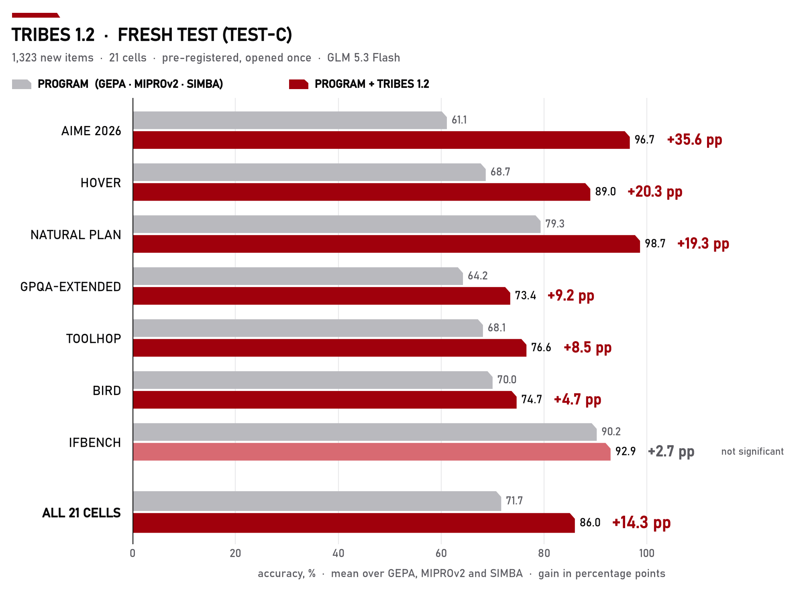

<p align="center">
  <picture>
    <source media="(prefers-color-scheme: dark)" srcset="https://raw.githubusercontent.com/daglar-dragomirov/tribes/main/assets/lockup-dark.png">
    
  </picture>
</p>

<p align="center">
Inference-time answer selection for optimized DSPy programs
</p>

<p align="center">
  <a href="https://daglar-dragomirov.github.io/tribes/"><b>Website</b></a> &nbsp;|&nbsp;
  <a href="https://daglar-dragomirov.github.io/tribes/guides/quickstart/"><b>Quick Start</b></a> &nbsp;|&nbsp;
  <a href="https://daglar-dragomirov.github.io/tribes/results/"><b>Results</b></a> &nbsp;|&nbsp;
  <a href="research/"><b>Research</b></a> &nbsp;|&nbsp;
  <a href="https://pypi.org/project/tribes/"><b>PyPI</b></a>
</p>

<p align="center">
  <a href="https://pypi.org/project/tribes/"></a>
  <a href="https://pypi.org/project/tribes/"></a>
  <a href="https://github.com/daglar-dragomirov/tribes/stargazers"></a>
  <a href="LICENSE"></a>
</p>

---

<p align="center">
  <b>+14.3 percentage points</b> over the optimizer's own program on <b>1,323 fresh test items</b><br>
  TRIBES 1.2 · GEPA, MIPROv2 and SIMBA · pre-registered, opened once · 6 of 7 benchmarks significant
</p>

<p align="center">
  <picture>
    <source media="(prefers-color-scheme: dark)" srcset="https://raw.githubusercontent.com/daglar-dragomirov/tribes/main/assets/chart-testc-dark.png">
    
  </picture>
</p>

| | AIME 2026 | HoVer | NATURAL PLAN | GPQA-ext. | ToolHop | BIRD | IFBench | **all 21 cells** |
|---|---|---|---|---|---|---|---|---|
| optimized program | 61.1 | 68.7 | 79.3 | 64.2 | 68.1 | 70.0 | 90.2 | **71.7** |
| **+ TRIBES 1.2** | **96.7** | **89.0** | **98.7** | **73.4** | **76.6** | **74.7** | 92.9 | **86.0** |
| gain, pp | **+35.6** | **+20.3** | **+19.3** | **+9.2** | **+8.5** | **+4.7** | +2.7 | **+14.3** |

Accuracy in %, mean over the three optimizers; bold gains are significant (one-sided α = 0.025, Holm over the seven
benchmarks; all cells: 95 % CI [+11.9, +16.8]). Details, every cell and the earlier tests: [Results](#results).

---

## What is TRIBES?

A prompt optimizer such as GEPA, MIPROv2 or SIMBA turns your data into one fixed [DSPy](https://github.com/stanfordnlp/dspy)
program. That program is good, but it is also brittle: it cannot look anything up, cannot run code to check itself, and
every answer is a single sample. TRIBES does not touch the optimization. It wraps the finished program with a
reviewer of its draft and an independent agent, picks one answer per input with a label-free rule, and switches itself
off on any task where it is not at least as good as the program. Since 1.2 the reviewer and the agent can think longer
than the program (their own LM at a higher reasoning effort), which is where most of the new gain comes from.

## Install

```bash
pip install tribes
```

## Quickstart

```python
import dspy
import tribes
from tribes import Tribes

dspy.configure(lm=dspy.LM("openrouter/z-ai/glm-5.3-flash"))

program = dspy.GEPA(metric=metric, ...).compile(student, trainset=train, valset=val)   # or MIPROv2, SIMBA, ...

pt = Tribes(program, mode="full", examples=train,
                task=tribes.tasks.math(),   # optional: how answers compare, checks, tools
                verifier=True)                  # optional: settle contested items by a check
pt.fit(train + val, metric)        # decides once whether the layer (and the verifier) helps this task
print(pt.report["use_layer"], pt.report["mean_gain"])

prediction = pt(question="...")    # same call signature as your program
```

TRIBES 1.2 lets the layer's own agents think longer than the program: give them their own LM. On tool tasks (multi-hop
QA, retrieval) also give them more steps and one fresh run when they return nothing or abstain:

```python
agent_lm = dspy.LM("openrouter/z-ai/glm-5.3-flash", reasoning_effort="high", max_tokens=32768)
pt = Tribes(program, agent_lm=agent_lm, examples=train)                       # reasoning tasks
pt = Tribes(program, agent_lm=agent_lm, max_iters=16, agent_retry=True,       # tool tasks
            task=tribes.tasks.tool_qa(), examples=train)
```

The program itself keeps your task LM; so does the program's draft inside the reviewer.

`fit` only needs labeled data the optimizer already saw; nothing is tuned per dataset.

## How it works

### Three forms

| form | what it is |
|---|---|
| **rigid** | the optimized program itself, unchanged |
| **assembled** | the program writes a draft; a ReAct reviewer checks it against the task and fixes it only if it finds a concrete defect |
| **liquid** | a ReAct agent that solves the task from scratch |

Both agents get the same task-agnostic instructions: the program's own instructions (the task's purpose plus what the
optimizer learned), a few correct outputs from your examples, and one fixed template per form. They have `run_python`
and any task tools you pass. There is no task-specific prompt text anywhere.

### One answer per input

1. Drop forms whose output is missing or unparsable.
2. If you pass a deterministic, label-free `checker` (public unit tests, a SQL query that must run, a plan validator), drop
   forms that fail it. If all fail, keep all.
3. If two forms give the same answer, return it. Answers are compared with `answer_key` (default: normalized text).
4. Otherwise return the reviewer's answer, then the program's, then the agent's.

In `full` mode the program and the reviewer run concurrently, and the agent only when they disagree. `lite` mode runs
the reviewer only. Every form and every retry is an independent request (its own cache entry), so the vote never
compares a form with a cached copy of itself.

### Agents that think longer (1.2)

`agent_lm` gives the reviewer and the agent their own LM, typically the task model at a higher reasoning effort; the
program and its draft keep your task LM. On tool tasks `max_iters=16` and `agent_retry=True` add steps and one fresh run
when an agent returns nothing or abstains. On TEST-C this took the layer from +11.5 to +14.3 pp over the programs on the
same items, and beat the program run at the same high effort by +6.4 pp.

### Contested inputs: the verifier

When no two forms agree, an optional verifier settles the input by evidence, not opinion: it must design and run one
check whose outcome differs between the candidates (substituting an answer back, code on edge cases, an auxiliary SQL
query), and code, not the model, accepts a switch only if the quoted evidence matches a tool observation. A switch needs
two of three votes. `fit` enables the verifier per task only if it wins clearly more items than it loses.

### Task adapters

`tribes.tasks` ships what the research used per task type, all label-free: `math()` (answers compare by value),
`choice()` (option letters), `sql(db_for)` (result-set agreement, a read-only `run_sql` tool, "the query runs"),
`code(tests_for)` (behavioural agreement on the public-test inputs, `run_public_tests`), `plan(validate)` (stated
constraints), `tool_qa()` (an abstention is not an answer) and `free_text()`.

For outputs that are sets of items scored by recall (retrieved documents, cited sources), `doc_set()` merges instead of
selecting: an element-wise vote over the forms' sets, capped at the program's own output size. On HoVer this beat
taking the reviewer's set by about +6 pp on development data for every optimizer.

### Never worse than the program

`fit` runs the forms on labeled selection data and compares TRIBES with the program item by item. With the default
`switch="do_no_harm"` (the 1.0 rule) the layer is used unless it is shown worse by more than one clustered standard
error; `switch="non_inferiority"` accepts it only if it is shown to be at most `margin` worse. `switch_power` gives the
operating characteristic of either for your sample size. If the layer is not used, the wrapped object is exactly the
program, at exactly its cost.

## Results

GLM 5.3 Flash as the task model; each optimizer run with its official settings; every number is TRIBES minus that
optimizer's own program on the same items.

**At a glance**

| benchmark | fresh test · 1.2 | fresh test · 1.1 | sealed test · 1.0-lite | development · 1.1 |
|---|---|---|---|---|
| AIME | **+35.6** (2026) | — | — | +31.1 |
| HoVer | **+20.3** | +12.4 | — | +12.6 |
| NATURAL PLAN | **+19.3** | — | +13.7 | +21.0 |
| GPQA | **+9.2** (extended) | +1.7 | +2.5 | +3.6 |
| ToolHop | **+8.5** | +2.2 | +1.3 | +4.7 |
| BIRD | **+4.7** (simple) | +3.2 | +5.0 | +23.2 |
| IFBench | +2.7 | — | — | +1.6 |
| LiveCodeBench | — | — | +13.0 | +20.0 |
| LiveBench | — | — | — | +17.4 |
| HotpotQA | — | +4.2 | — | +3.4 |
| PUPA | — | — | — | +1.2 |
| BFCL | — | — | — | 0.0 |
| τ²-bench | — | — | — | 0.0 |
| **all cells** | **+14.3** (21 cells) | **+4.7** (15 cells) | **+7.1** (15 cells) | **+11.6** (36 cells) |

Mean over GEPA, MIPROv2 and SIMBA, in percentage points over each optimizer's own program. The three tests were frozen
before they were opened and are the numbers to quote; they are separate tests on different items and are never pooled.
Development numbers are post hoc (the components were designed while these outputs were visible): read them as an upper
bound. — : no held-out items for that benchmark in that test. Bold in the 1.2 column: significant after Holm.

**Fresh test (TEST-C, TRIBES 1.2)** — 1,323 new items, used nowhere in development or in the earlier tests; the 1.2
settings and the analysis were pre-registered before any model saw them (chart at the top of this page):

| benchmark (test items per cell) | over GEPA | over MIPROv2 | over SIMBA | benchmark mean, 95 % CI |
|---|---|---|---|---|
| AIME 2026 (30, shared) | +36.7 | +43.3 | +26.7 | **+35.6** [+24.4, +47.8] |
| HoVer (100) | +23.0 | +19.0 | +19.0 | **+20.3** [+16.0, +25.0] |
| NATURAL PLAN (50) | +18.0 | +22.0 | +18.0 | **+19.3** [+13.3, +26.0] |
| GPQA-extended (33) | +12.1 | +6.1 | +9.4 | **+9.2** [+2.1, +16.4] |
| ToolHop (98) | +12.1 | +6.1 | +7.1 | **+8.5** [+4.7, +12.5] |
| BIRD simple (100) | +5.0 | +5.0 | +4.0 | **+4.7** [+1.3, +8.0] |
| IFBench (50) | +7.7 | 0.0 | +0.3 | +2.7 [−0.2, +5.9] |
| **mean** | +16.4 | +14.5 | +12.1 | **+14.3** [+11.9, +16.8] |

Every pre-registered claim holds, in order: 1.2 beats the program (+14.3, p = 0.0001); 1.2 beats 1.1 on the same items
(**+2.8** [+1.3, +4.3]); and 1.2 beats the program run at the same high reasoning effort (**+6.4** [+4.3, +8.5]), so
the gain is the layer, not just more thinking: on HoVer, ToolHop and BIRD that compute-matched control gains under two
points. The exception, reported as is: on GPQA-extended (+14.4) and IFBench (+4.1) the program at high effort alone
beats 1.2, whose program form keeps the task model's effort; those two reward thinking more than extra forms.

**Fresh test (TEST-B, TRIBES 1.1)** — 1,010 new items, used nowhere in development or in the sealed test; the 1.1
policy and the analysis were pre-registered before any model saw them:

<picture>
  <source media="(prefers-color-scheme: dark)" srcset="https://raw.githubusercontent.com/daglar-dragomirov/tribes/main/assets/chart-testb-dark.png">
  
</picture>

| benchmark (test items) | over GEPA | over MIPROv2 | over SIMBA | benchmark mean, 95 % CI |
|---|---|---|---|---|
| HoVer (150) | +12.7 | +8.0 | +16.7 | **+12.4** [+8.9, +16.4] |
| HotpotQA (200) | +7.0 | +3.0 | +2.5 | **+4.2** [+1.8, +6.8] |
| BIRD (300) | 0.0 | +5.0 | +4.7 | **+3.2** [+0.9, +5.7] |
| ToolHop (200) | +3.5 | +3.5 | −0.5 | +2.2 [−0.5, +5.0] |
| GPQA (160) | +0.6 | +4.4 | 0.0 | +1.7 [−1.5, +4.8] |
| **mean** | +4.8 | +4.8 | +4.7 | **+4.7** [+3.4, +6.1] |

Bold: significant (one-sided α = 0.025, Holm over the five benchmarks; the mean: p = 0.0001). Pre-registered
expectation: about +6 pp. On the same items TRIBES 1.0-lite gains +2.5 pp, so 1.1 adds **+2.2 pp** [+1.5, +3.0] over 1.0.
On HoVer the set merge beats merging three samples of the program by **+7.1 pp** [+4.4, +10.2]: the gain is not just
more sampling.

**Sealed test (TEST-A)** — opened once, after the rule and every per-task decision were frozen (TRIBES 1.0-lite):

| benchmark (test items) | over GEPA | over MIPROv2 | over SIMBA |
|---|---|---|---|
| NATURAL PLAN (200) | **+13.5** | **+17.0** | **+10.5** |
| LiveCodeBench (82) | **+11.0** | **+14.6** | **+13.4** |
| BIRD (200) | +2.5 | **+9.0** | +3.5 |
| GPQA (80) | +3.8 | 0.0 | +3.8 |
| ToolHop (200) | +2.5 | +2.0 | −0.5 (1 item of 200) |
| **mean** | **+6.7** | **+8.5** | **+6.1** |

Bold: 95 % confidence interval above zero. No cell has its interval below zero.

**Development (TRIBES 1.1)** — 13 benchmarks × 3 optimizers = 36 cells, post hoc:

| benchmark | over GEPA | over MIPROv2 | over SIMBA |
|---|---|---|---|
| AIME | +38.0 | +23.3 | +32.0 |
| BIRD | +28.5 | +15.0 | +26.0 |
| NATURAL PLAN | +24.0 | +18.0 | +21.0 |
| LiveCodeBench | +20.0 | +20.0 | +20.0 |
| LiveBench | +15.3 | +21.4 | +15.6 |
| HoVer | +12.3 | +9.7 | +15.7 |
| ToolHop | +9.0 | +0.5 | +4.5 |
| HotpotQA | +2.7 | +1.7 | +5.7 |
| GPQA | +0.8 | +9.3 | +0.8 |
| IFBench | +2.2 | 0.0 | +2.6 |
| PUPA | +1.7 | 0.0 | +1.8 |
| τ²-bench | 0.0 | — | — |
| BFCL | 0.0 | — | 0.0 |

| | TRIBES 1.1 | 1.0 full | 1.0 lite |
|---|---|---|---|
| over GEPA | +11.9 | +10.1 | +9.3 |
| over MIPROv2 | +10.8 | +8.7 | +8.4 |
| over SIMBA | +12.1 | +9.6 | +8.9 |
| **all 36 cells** | **+11.6** | **+9.5** | **+8.9** |

No cell below the program. What 1.1 adds over 1.0 here: BIRD agents that can run SQL, the set merge on HoVer, the
abstention check on ToolHop, the verifier on AIME, LiveBench and LiveCodeBench, and a per-task choice of `lite` or `full`
(every choice made on selection data). These numbers are post hoc; the per-cell audit and the frozen decisions are in
`research/reports/FABLE-FREEZE-TESTB-20261120.md`.

**Research record**: how the rule was found, frozen and tested, with every number per cell, is in [`research/`](research/).

**Settings per task type** used in the tests (each decided on selection data by a gate fixed in advance):

| task type (benchmarks) | mode | agents' reasoning effort | agent steps · retry | extra |
|---|---|---|---|---|
| math (AIME, LiveBench) | `full` | high | 8 · no | — |
| multiple choice (GPQA) | `lite` | high | 8 · no | — |
| text-to-SQL (BIRD) | `lite` | high | 8 · no | agents get `run_sql` |
| planning (NATURAL PLAN) | `full` | high | 8 · no | the plan validator as checker |
| instruction following (IFBench) | `lite` | high | 8 · no | — |
| tool QA (ToolHop) | `full` | high | 16 · yes | an abstention is not an answer |
| retrieval sets (HoVer) | `full` | high | 16 · yes | `doc_set()` merge |
| code (LiveCodeBench) | `full` + verifier | task model | 8 · no | public tests as checker |
| multi-hop QA, privacy rewrite (HotpotQA, PUPA) | `lite` | task model | 8 · no | — |
| function calling, agents (BFCL, τ²-bench) | layer off | — | — | the switch keeps the program |

Every entry was decided on the optimizer's own selection data (PARETO + FIT) by a gate fixed in advance, before the
tests were opened; "high" means `agent_lm` set to the task model at reasoning effort high (max_tokens 32,768).

**Cost**: about 2.6× the program's inference cost in `lite` mode and 4.6× in `full` mode with the agents on the task
model (1.1); with `agent_lm` at a higher reasoning effort (1.2) the agents cost more. There is no optimization cost.

## API

```python
Tribes(program, *, mode="full", task=None, tools=(), answer_key=None, checker=None, examples=None,
           verifier=None, switch="do_no_harm", z=None, margin=0.02, parallel=True, independent=True,
           callbacks=(), prices=None, input_fields=None, output_field=None, max_iters=8, retries=3,
           agent_lm=None, agent_retry=False)
```

| argument | meaning |
|---|---|
| `program` | any `dspy.Module`, usually an optimizer's output |
| `mode` | `"full"`: program + reviewer, agent on disagreement, vote · `"lite"`: reviewer only |
| `task` | a `tribes.tasks` adapter: answer key, checker, tools and verifier evidence for a task type |
| `tools` | task tools for both agents and the verifier (`run_python` is always included) |
| `answer_key` | `callable(prediction) -> hashable`: how two answers are compared |
| `checker` | `callable(inputs, prediction) -> bool \| None`: a deterministic, label-free check |
| `verifier` | `True` (or a `Verifier`) to settle contested inputs by an evidence-gated check |
| `switch`, `z`, `margin` | the task switch: `"do_no_harm"` (1.0) or `"non_inferiority"` |
| `parallel`, `independent` | run forms concurrently; give each form and retry its own cache entry |
| `callbacks`, `prices` | events (`LoggingCallback`, `JSONLCallback`, your own); `{model: (usd/M in, usd/M out)}` |
| `agent_lm` | the LM of the layer's own agents (reviewer and agent), e.g. the task model at a higher reasoning effort; the program keeps the task LM |
| `max_iters`, `agent_retry` | the agents' step limit; one fresh agent run when its output is empty or an abstention (1.2 on tool tasks: 16, `True`) |

| method | what it does |
|---|---|
| `fit(selection_set, metric, num_threads=8, cluster=None)` | the task decision; `report` holds the evidence |
| `pt(**inputs)`, `await pt.acall(**inputs)` | one prediction |
| `explain(**inputs)` | a `Selection`: every form's output, keys, checks, the verifier's votes |
| `run_batch(items)`, `await abatch(items)` | many inputs, in order |
| `cost_report()` | calls, failures, seconds, tokens and dollars per form; cost relative to the program |
| `save_fit(path)`, `load_fit(path)` | persist the task decision |

Command line: `tribes replay rows.jsonl --mode both` applies the rules to saved per-item outputs with no model
calls; `tribes report fit.json` prints a saved decision.

## FAQ

**Does it need a judge model?** No. Earlier versions used an LLM judge; it added +0.8 pp for most of the cost and was
removed. Agreement between independent forms and cheap deterministic checks do the job.

**Which optimizers?** Anything that produces a DSPy program. It was evaluated on GEPA, MIPROv2 and SIMBA.

**Is the 1.2 gain just more reasoning effort?** No. The program run at the same high effort gains +7.9 pp on TEST-C;
1.2 gains +14.3 and beats it by +6.4. On GPQA and IFBench, though, the program at high effort alone does better.

**Is `run_python` a sandbox?** No. It runs code in a subprocess with a 10-second limit. Run untrusted workloads in an
isolated environment.

**What if it does not help my task?** Then `fit` says so (`use_layer = False`) and you get the program back, unchanged.

## Citation

```bibtex
@software{dragomirov2026tribes,
  author = {Dragomirov, Daglar},
  title  = {TRIBES: Inference-time answer selection for optimized DSPy programs},
  year   = {2026},
  url    = {https://github.com/daglar-dragomirov/tribes}
}
```

## License

MIT
